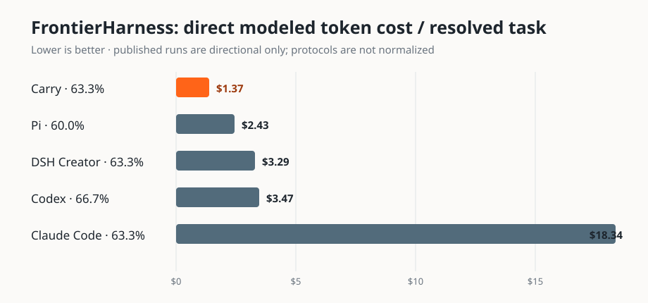

# Carry

A low-cost coding harness—or a context proxy for your favorite harness.

Carry manages stale context so your model can keep useful evidence without
carrying every old tool result forever. Use its built-in harness, or keep your
existing OpenAI Responses client and run Carry between it and the provider.

## How the proxy works

Carry forwards your client's requests and reviews eligible history in the
background. It keeps the original history and plans smaller contexts when modeled
savings or context limits justify a rewrite, accounting for review cost and
prompt-cache reuse. A request that fits never waits for a review.

When primary capacity or pricing is unknown, requests pass through without Carry
review, rewriting, or context-budget rejection. Unknown costs stay unpriced; a
context override does not invent a tariff or enable review. Savings are
experimental, workload-dependent estimates—not a billing guarantee.

## Install

```sh
curl -fsSL https://raw.githubusercontent.com/wiggzz/carry/main/install.sh | sh
```

Downloads the matching release, verifies its checksum, and installs to
`~/.local/bin`—no Rust toolchain required. See the
[installation guide](docs/harness-usage.md#one-line-install) for supported platforms,
manual downloads, and macOS notes.

## Use your favorite harness

```sh
carry login   # or set OPENAI_API_KEY
carry proxy
```

Point your client's OpenAI Responses base URL at `http://127.0.0.1:8787/v1`.
The client chooses the primary model; Carry handles upstream authentication and
opens a local usage dashboard. Reviews consume API or subscription capacity.

See [proxy setup](docs/proxy-benchmarking.md#standalone-proxy) for client
configuration, gateway authentication, and persistent state, or the
[Pi launcher](docs/proxy-benchmarking.md#everyday-pi-launcher) for a ready-made wrapper.

## Or use Carry's harness

```sh
carry --cwd /path/to/disposable/repo fix the failing tests
```

Run without a prompt for the browser UI; add `--interactive` for terminal follow-ups.
Sessions retain the patch, trace, and usage record. See the
[harness guide](docs/harness-usage.md) and `carry --help` for more.

> **Safety:** Carry's shell is **not** a sandbox. Use a disposable checkout and
> keep secrets, credentials, and unrelated work out of reach.

## Harness benchmarks

### Official SWE-bench Verified 50

Carry's latest fixed 50-task run used `gpt-5.6-luna`, medium reasoning, a
360-second task limit, `economic` compaction, and the five-request payoff horizon.
It resolved **41 / 50 (82%)** for **$0.576700** modeled model cost in **46m49s**.

| Harness | Resolved | Modeled model cost | Workflow wall time |
| --- | ---: | ---: | ---: |
| [Carry — current context policy](https://github.com/wiggzz/carry/actions/runs/34779347812) | 41 / 50 (82%) | $0.576700 | 46m49s |
| [Pi — prior fixed-catalog reference](https://github.com/wiggzz/carry/actions/runs/32549988183) | 36 / 50 (72%) | $0.661475 | 45m00s |
| [Codex — prior fixed-catalog reference](https://github.com/wiggzz/carry/actions/runs/32547842935) | 37 / 50 (74%) | $1.045054 | 46m38s |

Against the prior fixed-catalog references, Carry is **10 percentage points higher**
in resolved rate and **12.8% lower-cost** than Pi; against Codex, it is **8 points
higher** and **44.8% lower-cost**. These are single benchmark runs, so stochastic variance applies. They are useful
indicators of performance and modeled cost, not conclusive rankings.

### FrontierHarness 30

Carry resolved **19 / 30 (63.3%)** on a frozen Terminal-Bench + DataCurve mix,
with a **$25.9656411** direct modeled token-cost lower bound (**$1.3666 / pass**),
**5m51s** median recorded agent time, and **5h19m45s** workflow wall time. The
main run and its copy-only evidence recovery are
[artifact-gated](docs/benchmark-results.md#frontierharness-30).



On this directional performance-versus-cost chart, Carry sits on the plotted
efficiency frontier: **63.3%** resolved at a **$1.3666** direct modeled token-cost
lower bound per pass. Versus the published Pi point, that is **5.5% higher pass
rate** (+3.3 points) and **43.8% lower cost/pass**. Versus Codex, Carry is
**60.6% lower cost/pass** but **5.1% lower** in pass rate (−3.4 points). **It is
directional, not a head-to-head claim:** task IDs partly overlap, but agent/model
versions, evaluator/runtime/egress policy, timeouts, and verifier semantics are
not normalized.

Read [benchmark evidence](docs/benchmark-results.md) for immutable run links,
configuration, accounting, recovery provenance, and limitations. One run is
useful evidence, not a general quality ranking.

## More

- [Context-policy design](docs/context-policy.md) and [proxy history contract](docs/proxy-fork-continuity.md)
- [Local session cost report and experimental savings scenario](docs/local-session-cost-report.md) (`carry report cost`)
- [Benchmark isolation and maintainer operations](docs/benchmark-isolation.md)

## Development

```sh
cargo fmt -- --check
cargo clippy --all-targets -- -D warnings
cargo test
python3 scripts/run_python_integration.py --jobs 2
cargo build --release --locked
```

Run both Rust and Python tests for complete coverage. The Python runner builds
this checkout and runs the transparent-history and Noodle regression suites.
Contributions use Conventional Commit titles.
